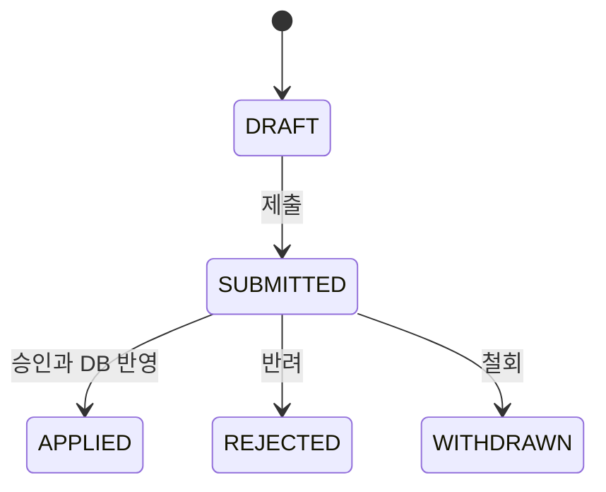

# MstChgMgmt

[](https://github.com/HwanDevBlog/MstChgMgmt/actions/workflows/backend-ci.yml)
[](https://github.com/HwanDevBlog/MstChgMgmt/actions/workflows/frontend-ci.yml)

장비 기준정보의 일괄 변경 과정에서 발생하는 CSV 검증, 변경 요청의 소유권과 승인 대상의 일치 문제를 다루는 토이 프로젝트입니다.

단순 CRUD보다 다음 문제를 코드와 테스트로 확인하는 데 초점을 맞췄습니다.

- 잘못된 형식이나 중복 장비 코드가 포함된 CSV를 찾아내는가
- 로그인한 사용자만 자신의 변경 요청을 작성하고 조회할 수 있는가
- 계정이 비활성화되거나 역할이 회수되면 기존 세션의 접근도 차단되는가
- 승인자가 검토한 제출본과 실제 DB에 반영되는 내용이 일치하는가

세션 로그인부터 CSV 업로드·검증·비교, 불변 제출본, 승인·실제 기준정보 반영, 반려·철회·새 리비전과 처리 이력까지 핵심 업무 흐름을 구현했습니다. GitHub Actions 검증은 후속 단계입니다.

## 구현 범위

- 세션 기반 로그인·로그아웃과 CSRF 검사
- 로그인 시 세션 ID 갱신과 로그인·로그아웃 후 CSRF 토큰 갱신
- 비활성 계정 차단과 API 요청 시 계정 상태·역할 재확인
- 요청자·승인자·조회자의 현재 장비 기준정보 조회
- 요청자의 본인 임시 요청 생성·목록·상세·리비전 조회
- 서버에서 인증 사용자와 요청 소유권 검사
- 본인 현재 임시 리비전의 CSV 업로드·원본 보존·다운로드
- CSV 형식·필드·파일 내 중복 검증과 원본 바이트 SHA-256 계산
- CREATE 존재·UPDATE 미존재 검사와 신규·변경·변경 없음 분류
- 필드별 변경 전후 값·기대 버전 저장과 기준정보 변경 감지
- 파일 교체 시 기존 검증 결과 폐기
- 임시 요청의 변경 사유 수정과 제출 내용 확인
- 내용 해시·파일 ID·검증 ID 대조 후 불변 제출본 저장
- 제출본 저장과 SUBMITTED 상태 전환의 단일 트랜잭션 처리
- 동일한 제출 재요청의 기존 영수증 반환
- 타인의 승인 대기 요청 조회와 고정 제출본 검토
- 승인·기준정보 반영·성공 이력·최종 상태의 단일 트랜잭션 처리
- 같은 승인자의 중복 요청 방지와 다른 승인자의 중복 결정 차단
- 반려 사유 기록, 본인 요청 철회와 새 리비전 작성
- 과거 리비전·고정 제출본과 실제 변경 이력 조회
- 조회자의 반영 완료 이력 조회와 원본 CSV 접근 구분
- 리비전 상태·역할·소유권에 따른 도메인 접근 정책
- 스키마 소유자와 앱 DB 계정의 권한 분리
- 종료·재실행 후에도 유지되는 로컬 PostgreSQL 데이터
- React 기반 로그인·기준정보·내 변경 요청 화면

## 핵심 설계

### 변경 요청과 리비전

`ChangeRequest`는 작성자와 현재 리비전을 가리키고, `ChangeRevision`은 리비전 번호, 상태, 변경 사유를 보관합니다. 요청과 첫 `DRAFT` 리비전은 하나의 트랜잭션에서 생성합니다.

현재 리비전 포인터에는 요청 ID와 리비전 ID를 함께 검사하는 복합 외래 키를 적용했습니다. 다른 요청의 리비전이 현재 리비전으로 지정되는 경우 DB에서 차단합니다.

도메인 정책에서 정의한 상태 흐름은 다음과 같습니다.



반려·철회한 리비전은 보존하고 다시 작성할 때 새 `DRAFT` 리비전을 생성하도록 설계했습니다. `APPLIED`는 최종 상태입니다. API에서 제출·승인·반려·철회·새 리비전 생성을 제공합니다. 반려와 철회는 기존 리비전을 되돌리지 않고 상태와 제출본을 보존합니다. 새 리비전에는 사유·원본 파일을 복사하되 파일 ID를 새로 발급하고 검증을 다시 수행합니다.

### 인증과 객체 접근 권한

- 사용자 ID는 인증된 세션에서 가져옵니다. 요청 본문으로 작성자를 지정할 수 없습니다.
- URL별 역할 검사와 서비스의 객체 소유권 검사를 함께 적용합니다.
- 다른 요청자의 임시 요청을 조회하면 `403`, 생성 요청에 `requesterId`를 보내면 `400`으로 처리합니다.
- API 권한 검사 전에 계정 상태와 역할을 DB에서 다시 읽어 세션의 과거 권한으로 접근하지 않게 합니다.
- 화면 메뉴는 역할에 맞게 표시하고, 계정 전환·인증 만료 시 이전 목록과 상세 데이터를 비웁니다.
- Spring Security의 세션 CSRF 저장소를 사용하며, 프론트엔드는 변경 요청 전에 마스킹 토큰을 새로 조회합니다.

자기 승인·반려와 구 리비전 결정 차단은 도메인 정책과 실제 API에서 검사합니다. 이중 역할 계정도 자신의 요청을 승인하거나 반려할 수 없습니다. 반영 완료 상세·변경 이력은 세 역할 모두 조회할 수 있지만, 원본 CSV 접근은 별도 정책을 적용합니다.

### CSV 검증과 정수 정밀도

Commons CSV로 따옴표와 쉼표를 처리하며, 빈칸이나 대소문자를 자동 보정하지 않습니다. UTF-8과 BOM, 1MiB·200레코드 제한, 고정 헤더, 필드 형식과 파일 내 중복 장비 코드를 검증합니다.

CSV 원본 바이트의 SHA-256은 파일 식별에 사용합니다. 변경 내용을 고정하는 제출 내용 해시는 별도 바이너리 직렬화 계약으로 구현했습니다.

장비 금액과 버전은 JSON 문자열로 전달합니다. 프론트엔드는 `bigint`로 금액을 표시해 JavaScript 숫자 변환으로 정수 정밀도가 손실되는 것을 막습니다.

### 파일 교체와 검증 결과

리비전별 `revision_workspace`에 CSV 원본 바이트, 파일 ID·해시와 검증 결과를 저장합니다. 파일을 교체하면 파일 ID를 새로 발급하고 이전 검증 결과를 같은 트랜잭션에서 폐기합니다. 검증 요청이 보낸 파일 ID와 현재 저장된 파일이 다르면 `409`로 거절합니다.

검증 시 기준정보를 한 번에 조회해 신규·변경·변경 없음을 분류하고, 변경 전후 값과 기대 버전을 저장합니다. 파일 전체의 오류가 없어야 검증 완료로 표시합니다. 검증 자체는 장비 기준정보를 변경하지 않습니다.

결과를 다시 조회할 때 저장된 변경 전 값·버전과 현재 기준정보를 비교합니다. 화면의 `최신 상태 확인` 버튼이나 상세 재조회에서 차이가 발견되면 이전 비교값은 유지하고 재검증 필요를 표시합니다. 검증 직후 기준정보가 계속 고정된다는 의미는 아니며, 제출 시에는 같은 검증 결과를 대조하고 현재 기준정보를 다시 조회해 차이가 있으면 거절합니다. 승인 시에는 고정 제출본과 현재 기준정보를 다시 대조하고 장비 행을 잠가 변경과 이력을 함께 반영합니다.

### 불변 제출본과 내용 해시

제출 확인 API는 사유·파일·전후 값·기대 버전·내용 해시를 한 묶음으로 반환합니다. 화면은 실제 표시한 묶음의 `fileId`·`validationId`·`contentHash`만 제출 API에 보냅니다. 확인 이후 파일·검증 결과·사유가 바뀌면 `409`로 거절하며, 식별자를 자동 갱신해 재제출하지 않습니다.

내용 해시는 `catalog-submission-v1` 길이 접두사 바이너리 계약을 사용합니다. 장비 코드순 정렬, UTF-8 바이트 길이, big-endian 정수와 명시적인 값 존재 여부를 직렬화한 뒤 SHA-256을 계산합니다. 변경 없음 행도 포함합니다. Java와 독립적으로 계산한 고정 벡터로 같은 해시가 생성되는지 확인했습니다.

제출 시에는 본인 현재 `DRAFT`, 필수 사유, 오류 없는 검증, 실제 변경 존재와 검증 이후 기준정보 변경 여부를 검사합니다. 원본 바이트와 전체 검토 묶음은 `revision_submission`에 복사하고 리비전의 `SUBMITTED` 전환과 함께 커밋합니다. 앱 계정에는 제출본의 `SELECT`·`INSERT`만 허용하고, 별도 트리거로 `UPDATE`·`DELETE`를 차단합니다.

동일 제출의 재요청은 현재 사용자 권한과 동일한 파일·검증·해시를 확인한 뒤 기존 제출 영수증을 반환합니다. 제출 자체는 장비 기준정보를 변경하지 않습니다. 승인 재요청은 별도의 성공 영수증과 승인자·리비전·내용 해시로 검사합니다.

### 승인 원자 반영과 처리 이력

승인은 활성·승인자 역할·자기 승인 금지를 확인하고 요청과 현재 리비전을 잠급니다. 화면에서 확인한 리비전 ID·내용 해시를 서버의 고정 제출본과 대조한 뒤, 기존 장비를 코드순으로 잠그고 변경 전 값·기대 버전을 검사합니다.

신규 코드는 존재 여부와 UNIQUE 제약으로 동시 생성 충돌을 처리합니다. 실제 변경 행만 값을 반영하고 버전을 증가시키며, 변경 없음 행도 충돌은 검사하지만 버전과 변경 이력을 추가하지 않습니다.

장비 변경, `equipment_change`, `revision_decision`과 `APPLIED` 전환은 하나의 트랜잭션입니다. 중간 장비 갱신 또는 마지막 상태 갱신이 실패하면 모두 롤백합니다. 실패는 성공 이력에 기록하지 않고 오류 응답의 확인 번호(`traceId`)와 서버 로그로 진단합니다.

동일 승인자의 같은 리비전·해시 재요청은 기존 영수증을 반환합니다. 반환 전에 활성·역할·자기 승인 금지를 다시 검사하며 다른 승인자의 중복 결정은 거절합니다. 기준정보 충돌은 `SUBMITTED`를 유지하고 요청자가 철회한 뒤 새 리비전에서 재검토합니다.

반려는 사유가 필수이고 철회 사유는 선택입니다. 원본 제출본과 처리 이력은 수정하지 않습니다. 새 리비전 생성의 동일 재요청은 이미 만든 현재 임시 리비전을 반환합니다.

### DB 계정과 로컬 데이터 보존

- Flyway 마이그레이션은 별도 소유자 권한 연결로 처리합니다.
- 앱은 제한된 `mcr_app` 계정으로 접속하고 Hibernate `validate`로 스키마를 검사합니다.
- 앱 계정의 계정 정보 수정, 스키마 DDL과 소유자 역할 전환은 허용하지 않습니다. 승인 반영에는 장비 INSERT·UPDATE, 제출·처리·변경 이력에는 SELECT·INSERT만 부여합니다.
- 테스트 DB는 임시 디렉터리, 시연 DB는 프로젝트의 `.local/postgres-data`를 사용합니다.
- 시연 DB는 데이터 삭제를 끄고 `fsync`를 켜며, 같은 디렉터리의 중복 실행은 파일 잠금으로 차단합니다.

제출본 계약과 가상 업무 규칙은 [설계 문서](docs/DESIGN.md)에 정리했습니다.

## 기술 스택

| 구분 | 기술 |
|---|---|
| Language | Java 21 |
| Backend | Spring Boot 3.5, Spring MVC, Spring Data JPA, Spring Security |
| Query | Hibernate, JdbcTemplate |
| Database | PostgreSQL 16, Flyway |
| CSV | Apache Commons CSV |
| Test | JUnit 5, AssertJ, Spring Boot Test, Zonky Embedded PostgreSQL, Vitest, Testing Library, Playwright |
| Frontend | React 18, TypeScript, Vite |
| Build / CI | Gradle Wrapper, npm / GitHub Actions |

## 실행 방법

Java 21과 Node.js 24가 필요합니다. 별도의 PostgreSQL이나 컨테이너 없이 로컬 실행용 임베디드 PostgreSQL이 함께 시작됩니다. 최초 의존성 설치에는 네트워크가 필요합니다.

Windows에서 전체 서버 테스트 실행:

```powershell
.\scripts\dev.ps1 -Tasks test
```

프론트엔드 의존성 설치·빌드와 애플리케이션 실행(프로젝트 루트 기준):

```powershell
cd frontend
npm ci
npm run build
cd ..
.\scripts\dev.ps1 -Tasks localRun
```

`localRun`은 최초 실행 시 시연 계정 7개와 장비 3개를 생성합니다. 이후에는 기존 요청과 장비 값을 보존하고 초기 데이터를 덮어쓰지 않습니다. 종료는 실행 터미널에서 `Ctrl+C`를 사용합니다. DB·캐시·빌드 결과는 Git에서 제외합니다.

`dev.ps1`은 `JAVA_HOME` 또는 PATH의 JDK를 사용하며, 이 PC에서는 Eclipse의 Java 21 번들도 탐색합니다. 다른 PC에서는 `JAVA_HOME`을 Java 21 JDK로 지정하세요. Windows Gradle 캐시 이동 오류를 우회하는 옵션을 실행 프로세스에만 적용합니다.

DBeaver 연결 설정(애플리케이션 실행 중):

| 항목 | 값 |
|---|---|
| 연결 이름 | MstChgMgmt 로컬 |
| Host | 127.0.0.1 |
| Port | 15433 |
| Database | catalog_review |
| Username | mcr_app |
| Password | local-app-only |
| Schema | catalog |

이 접속 정보는 로컬 개발용 Embedded PostgreSQL 구성입니다. 루프백 주소에만 바인딩하며, 로컬 DB는 trust 인증을 사용합니다. 앱 계정의 권한 제한이 로컬 관리자 접근까지 막는다는 뜻은 아닙니다. 자동 테스트는 별도의 임시 DB를 사용합니다.

실행 후 확인할 수 있는 주소:

- 웹 화면: `http://127.0.0.1:18081`
- 로그인 사용자 조회: `http://127.0.0.1:18081/api/auth/me`
- 기준정보 조회: `http://127.0.0.1:18081/api/equipment`

로컬 요청자 로그인은 **`tester / 1`**입니다. 나머지 계정 비밀번호는 **`LocalDemo!2026`**입니다. 기존 requester_a 계정의 ID·역할·요청은 유지한 채 로그인 정보만 변경합니다. 자동 테스트용 계정은 별도로 유지합니다.

| 계정 | 역할 |
|---|---|
| tester, requester_b | 요청자 |
| approver, approver_b | 승인자 |
| viewer | 조회자 |
| dual | 요청자 + 승인자 |
| inactive | 비활성 계정, 로그인 차단 확인용 |

요청자로 로그인하면 현재 장비를 조회하고 변경 사유를 입력해 임시 요청을 저장할 수 있습니다. 내 변경 요청 화면에서 목록과 상세를 확인하고 CSV를 업로드·검증할 수 있습니다. 승인자는 `승인 대기`에서 타인의 고정 제출본을 검토하고 승인 또는 반려합니다. 조회자는 `반영 이력`에서 완료된 제출본과 실제 변경 이력을 조회합니다.

CSV 흐름 확인 방법:

1. 요청자 계정으로 로그인하고 `내 변경 요청`에서 사유를 입력해 임시 저장합니다.
2. CSV 파일 선택에서 [오류 샘플](samples/catalog-invalid.csv)을 선택하고 `파일 업로드` → `검증하기`를 누릅니다.
3. 대여료 오류를 확인하고 [변경 샘플](samples/catalog-change.csv)로 교체해 다시 업로드·검증합니다.
4. 신규·변경·변경 없음과 장비별 전후 값을 확인합니다. 초기 장비 데이터 기준으로 각 1건입니다.
5. `원본 다운로드`로 저장된 바이트를 확인하고, 재접속 후 요청 상세에서 같은 검증 결과를 조회합니다.
6. 검증 결과 아래 `제출 확인`에서 변경 사유를 저장하고 `제출 내용 확인`을 누릅니다.
7. 전후 값과 사유를 검토하고 확인 체크 후 `승인 요청 제출`을 누릅니다.
8. 승인 대기 상태와 고정 제출본·제출 ID·내용 해시를 확인합니다. 제출 후에는 파일·사유를 수정할 수 없습니다.
9. 다른 승인자 계정으로 로그인해 `승인 대기`에서 요청을 열고 확인 체크 후 `승인 및 반영`을 누릅니다. 반려할 때는 사유를 입력합니다.
10. `반영 이력`에서 실제 변경과 버전을 확인합니다. 반려·철회된 요청은 요청자 계정에서 `새 리비전 작성`으로 이어갑니다.

같은 페이지에서 새 요청이나 다른 사용자의 처리 결과를 확인하려면 `목록 새로고침`을 누릅니다. 브라우저 E2E는 시연 DB에 검증용 장비·요청·처리 이력을 남기며 초기 장비 값은 변경하지 않습니다.

기존 [신규 등록 샘플](samples/catalog-create.csv)도 사용할 수 있습니다. 샘플은 검증만으로 기준정보에 반영되지 않습니다.

프론트엔드 개발 서버 실행:

```powershell
cd frontend
npm run dev
```

백엔드가 `18081` 포트에서 실행 중이면 프론트엔드의 `/api` 요청을 백엔드로 전달합니다. 프론트엔드 주소는 `http://127.0.0.1:5174`입니다.

프론트엔드 타입 검사, 테스트, 빌드:

```powershell
npm run typecheck
npm run test:run
npm run build
```

실행 중인 로컬 서버에 연결하는 Chrome E2E 테스트(frontend 디렉터리 기준):

```powershell
$env:MCR_BASE_URL = 'http://127.0.0.1:18081'
npm run test:e2e
```

설치된 Chrome을 사용하며, E2E에서 생성한 검증용 임시 요청은 연결된 시연 DB에 남습니다.

프론트엔드를 빌드한 뒤 프로젝트 루트에서 `.\scripts\dev.ps1 -Tasks test,bootJar`를 실행하면 정적 화면이 포함된 JAR을 생성합니다. 일반 JAR 실행에는 별도로 준비된 DB 연결 설정이 필요하며, Embedded PostgreSQL은 운영 JAR에 포함되지 않습니다.

Eclipse에서는 Gradle Wrapper·Java 21·프로젝트별 Gradle user home `.gradle-user-home`을 사용합니다. 이 PC의 Gradle Arguments와 JVM Arguments에는 `-Dorg.gradle.internal.instrumentation.agent=false`를 지정합니다. 의존성 변경 후 F5 → Gradle → Refresh Gradle Project를 실행하고, 이클립스에서는 프로젝트 루트의 `MstChgMgmt - localRun.launch`를 우클릭 → Run As → MstChgMgmt - localRun으로 실행합니다. 이 공유 실행 구성은 `LocalApplication`을 실행하며, PostgreSQL 도구 메시지용 `LC_ALL=C`·`LANG=C`와 UTF-8 콘솔을 지정합니다. 실행 구성의 Working directory는 프로젝트 루트로 지정합니다. 로컬 실행기는 `frontend/dist`를 직접 제공하므로 프론트엔드 빌드가 먼저 필요합니다. 이미 빌드한 뒤 서버 코드만 바꿨다면 F5로 새로고침하고 서버를 종료·재실행하면 됩니다.

## 주요 API

| Method | URL | 설명 |
|---|---|---|
| `GET` | `/api/auth/csrf` | 변경 요청에 사용할 CSRF 토큰 조회 |
| `POST` | `/api/auth/login` | 아이디·비밀번호로 세션 로그인 |
| `POST` | `/api/auth/logout` | 세션 로그아웃 |
| `GET` | `/api/auth/me` | 로그인 사용자와 역할 조회 |
| `GET` | `/api/equipment` | 현재 장비 기준정보 조회 |
| `POST` | `/api/requests` | 본인 임시 요청 생성 |
| `GET` | `/api/requests/mine` | 본인 요청 목록 조회 |
| `GET` | `/api/requests/{requestId}` | 접근 정책에 따른 요청 상세 조회 |
| `GET` | `/api/requests/{requestId}/revisions/{revisionId}` | 접근 정책에 따른 리비전 상세 조회 |
| `POST` | `/api/requests/{requestId}/revisions/{revisionId}/file` | 현재 임시 리비전의 CSV 업로드·교체 |
| `GET` | `/api/requests/{requestId}/revisions/{revisionId}/file` | 권한에 따른 원본 파일 다운로드 |
| `POST` | `/api/requests/{requestId}/revisions/{revisionId}/validation` | 파일 ID를 대조해 검증·비교 결과 저장 |
| `GET` | `/api/requests/{requestId}/revisions/{revisionId}/workspace` | 파일·검증 결과와 기준정보 변경 여부 조회 |
| `POST` | `/api/requests/{requestId}/revisions/{revisionId}/reason` | 본인 현재 임시 리비전의 변경 사유 수정 |
| `GET` | `/api/requests/{requestId}/revisions/{revisionId}/submission-preview` | 제출할 전체 검토 묶음과 내용 해시 조회 |
| `POST` | `/api/requests/{requestId}/revisions/{revisionId}/submission` | 검토 식별자 대조 후 고정 제출본 저장 |
| `GET` | `/api/requests/{requestId}/revisions/{revisionId}/submission` | 접근 정책에 따른 고정 제출본 조회 |
| `GET` | `/api/approvals/pending` | 승인자의 타인 승인 대기 목록 조회 |
| `GET` | `/api/history/applied` | 반영 완료 목록 조회 |
| `POST` | `/api/requests/{requestId}/approve` | 고정 제출본 승인과 실제 반영 |
| `POST` | `/api/requests/{requestId}/reject` | 사유를 기록해 반려 |
| `POST` | `/api/requests/{requestId}/withdraw` | 본인 제출 요청 철회 |
| `POST` | `/api/requests/{requestId}/revisions` | 반려·철회한 현재 리비전에서 새 임시 리비전 생성 |
| `GET` | `/api/requests/{requestId}/history` | 권한에 따른 리비전 이력 조회 |
| `GET` | `/api/requests/{requestId}/revisions/{revisionId}/decision` | 처리 영수증과 실제 변경 이력 조회 |

로그인은 form 형식의 `username`·`password`, 임시 요청 생성은 JSON 형식의 `reason`을 받습니다. 파일 업로드는 multipart 형식의 `file`, 검증은 JSON 형식의 `fileId`를 받습니다. 제출 요청은 JSON 형식의 `fileId`·`validationId`·`contentHash`를 받으며 클라이언트 변경값은 허용하지 않습니다. 결정·새 리비전 생성 요청은 `revisionId`·`contentHash`를 받으며 반려에는 `reason`도 필요합니다. 모든 `POST` 요청은 CSRF 토큰이 필요합니다.

## 테스트에서 확인하는 내용

- CSV 인코딩·크기·레코드 수·헤더·필드와 파일 내 중복을 검증하는지
- 리비전 상태·역할·소유권을 조합한 도메인 정책이 허용되지 않은 접근을 거절하는지
- 세션 로그인·로그아웃, CSRF 검사와 세션 ID 갱신이 실제 HTTP에서 동작하는지
- 비활성 계정과 로그인 이후 역할 회수가 다음 API 요청에 반영되는지
- 타인의 임시 요청 조회와 작성자 ID 조작이 서버에서 차단되는지
- 앱 DB 계정이 계정 정보를 수정하거나 스키마를 생성하고 소유자 역할로 전환할 수 없는지
- 실제 PostgreSQL 종료·재시작 후 장비 값·버전·임시 요청·CSV 원본·검증 결과와 초기 계정 수가 유지되는지
- 타인·다른 요청 조합·과거 리비전·제출된 상태에서 파일 조회와 수정 권한이 구분되는지
- 파일 교체 시 이전 검증이 폐기되고 오래된 파일 ID로 검증할 수 없는지
- 검증 뒤 기존 장비가 바뀌거나 신규 코드가 생성되면 재검증이 필요한지
- 프론트엔드가 CSRF 토큰을 갱신하고 작성자 ID 없이 요청을 전송하는지
- 큰 정수 금액이 화면에서 정밀도 손실 없이 표시되는지
- 실제 Chrome에서 로그인·임시 저장·새로고침·계정 전환 후 본인 데이터만 표시되는지
- 조회자가 화면을 우회해 API를 직접 호출해도 임시 요청을 생성할 수 없는지
- 내용 해시가 독립 고정 벡터와 일치하고 행 순서에 영향받지 않으며 사유·기대 버전·변경 없음 행까지 포함하는지
- 확인 이후 검증·파일·사유·기준정보·현재 리비전이 달라지면 제출이 거절되는지
- 같은 제출을 동시에 실행해도 제출본 1개와 동일한 영수증이 반환되는지
- 상태 변경 실패 시 이미 INSERT한 제출본까지 실제 PostgreSQL에서 롤백되는지
- 앱 DB 계정의 제출본 UPDATE·DELETE·TRUNCATE가 거절되고 소유자 UPDATE·DELETE도 트리거에서 거절되는지
- 실제 Chrome에서 표시한 검토 묶음의 식별자만 전송하고 충돌 시 재검토하며 제출 후 결과가 복원되는지
- 승인 시 변경 없음 행까지 버전을 검사하고 실제 변경 행만 버전·이력을 증가시키는지
- 중간 장비 갱신과 최종 상태 갱신 실패 시 장비·이력·영수증·상태가 함께 롤백되는지
- 같은 승인자 동시 요청, 다른 승인자의 결정 경합과 신규 코드 UNIQUE 경합을 실제 PostgreSQL에서 처리하는지
- 반려·철회 후 새 리비전에서도 과거 제출본·처리 결과가 보존되는지
- 조회자가 반영 이력은 조회하되 원본 CSV와 결정 명령에는 접근할 수 없는지
- 계정 전환 이전 처리의 늦은 응답으로 타인 요청이 새 화면에 표시되지 않는지

2026-10-15 기준 검증 결과:

| 구분 | 검증 결과 |
|---|---|
| CSV·권한·상태 단위 테스트 | 56건 통과 |
| 실제 PostgreSQL 연결 HTTP 인증·권한 테스트 | 20건 통과 |
| 실제 PostgreSQL 업로드·검증·비교 API 테스트 | 11건 통과 |
| 내용 해시 직렬화·고정 벡터 테스트 | 4건 통과 |
| 실제 PostgreSQL 제출·불변성·롤백·동시 제출 API 테스트 | 12건 통과 |
| 실제 PostgreSQL 승인·반려·철회·리비전·경합·롤백 API 테스트 | 13건 통과 |
| 실제 PostgreSQL 종료·재시작 보존 테스트 | 1건 통과 |
| 로컬 실행 화면·정적 파일 제공·API 인증 유지 테스트 | 2건 통과 |
| 로컬 시연 계정 변경·소유권 보존 테스트 | 1건 통과 |
| 프론트엔드 UI·CSRF·bigint·업무 흐름·계정 전환·검증 결과 이동 테스트 | 18건 통과 |
| 실제 서버에 연결한 Chrome E2E | 7건 통과 |

소유권 검사 제거 실험에서는 타인 상세 조회가 `200`이 되어 `403`을 기대한 대표 API 테스트가 실패했습니다. 원본 복원 후 전체 서버 테스트가 다시 통과했습니다. 실제 제출·승인·반영·반려·철회·새 리비전 생성은 API와 브라우저에서 확인했습니다. 계정 전환 응답 가드를 제거하면 타인 요청 상세가 다시 나타나며 회귀 테스트가 실패했고, 원본 복원 후 프론트엔드 전체 테스트가 통과했습니다.

2026-10-19 전체 UI 검수에서 로그인·기준정보·요청·검증·제출 검토·승인·반려·철회·반영 이력과 빈 목록을 데스크톱 1440px·모바일 390px로 확인했습니다. 실제 데이터 화면 11종과 GET 응답만 대체한 오류·빈 목록 2종을 총 26개 캡처로 확인했고, 표 헤더·본문 정렬과 페이지 가로 넘침·브라우저 실행 오류를 점검했습니다. 상세 선택·검증 완료 시 해당 영역으로 이동하며, 긴 목록은 내부 스크롤을 사용합니다.

서버 테스트 보고서는 `build/reports/tests/test/index.html`, 브라우저 캡처는 `frontend/test-results/`에서 확인합니다. GitHub Actions는 main push와 main 대상 pull request에서 백엔드·프론트엔드를 각각 검증하도록 구성했습니다. 백엔드는 Java 21에서 PostgreSQL 통합 테스트를 포함한 전체 서버 테스트를 실행하고, 프론트엔드는 Node 24에서 npm ci·타입 검사·UI 테스트·빌드를 실행합니다. Chrome E2E와 재시작 시연은 로컬 검증이며 CI 실행에는 포함하지 않았습니다. 2026-10-15 커밋 `cae4afa`의 [Backend CI](https://github.com/HwanDevBlog/MstChgMgmt/actions/runs/38705508866)와 [Frontend CI](https://github.com/HwanDevBlog/MstChgMgmt/actions/runs/38705508783)가 모두 성공했습니다.

## 개발 및 검증 방식

가상 장비 대여 조직을 기준으로 업무 규칙과 리비전·권한 정책을 정의했습니다. 구현 과정에서 AI 개발 도구를 보조적으로 활용했으며, 도메인 단위 테스트, 실제 PostgreSQL 기반 HTTP·권한·재시작 테스트와 프론트엔드 자동화 테스트로 동작을 확인했습니다.

도메인 정책 테스트와 실제 API·DB 검증의 범위를 구분해 기록합니다. 확정된 검증 결과와 다음 작업은 [인계 문서](docs/HANDOFF.md)에 정리했습니다.

## 현재 범위 밖의 항목

- OpenAPI 문서와 Swagger UI
- 회원 가입·계정 관리 화면과 운영 환경 배포 구성
- 컨테이너 런타임을 이용한 실행 검증

역할별 시연, 충돌 재현과 읽기 전용 DB 확인 순서는 [시연 안내](docs/DEMO.md)에 정리했습니다. 파일 상한은 성능 측정값이 아니며, 원본 파일 해시는 전자서명이나 승인 증명이 아닙니다.
